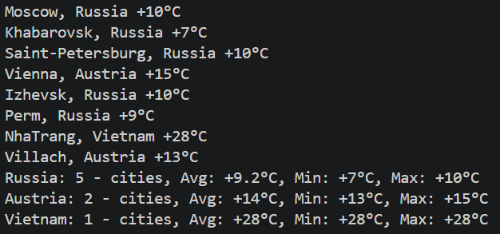

# Weather Parser

Программа представляет собой скрипт на Python для парсинга данных о погоде по нескольким городам из предоставленного файла

## Процесс
1. Чтение данных с файла
2. Запросы к API
3. Форматирование вывода по заданию

## Оптимизация

Для оптимизации код был адаптирован под асинхронные операции с помощью стандарнной библиотеки asyncio. 

Запускаем все запросы одновременно через asyncio.gather. Чтобы не блокировать цикл событий (event loop) внутри каждого запроса создается отдельный поток, для выполнения urllib, так как он блокирующий

## Запуск

```
python main.py
```

## Результат

